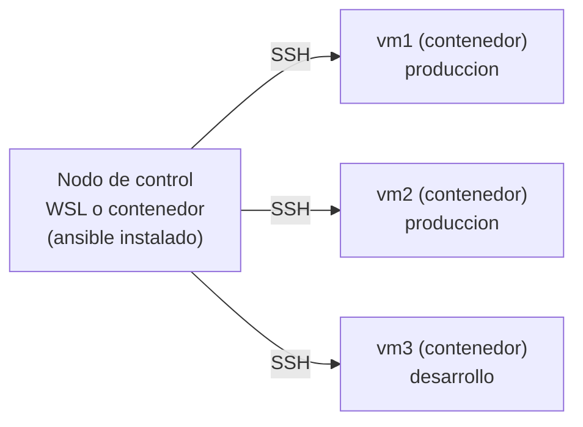

# Práctica de Ansible

En esta práctica vas a administrar **varios servidores desde un único lugar** con Ansible: primero con comandos sueltos (ad-hoc) y después con playbooks.

### El escenario
*   **Nodo de control:** la máquina desde donde se ejecuta Ansible. Ansible se instala **solamente ahí**. Tenés dos opciones, y el resto de la práctica es igual:
    *   **Control en WSL (recomendado):** tu Ubuntu de *Windows Subsystem for Linux*.
    *   **Control en contenedor:** un contenedor Docker que ya trae Ansible instalado. Sirve si no tenés WSL, si querés un entorno descartable, o si algo falla en tu instalación.
*   **Máquinas controladas:** `vm1`, `vm2` y `vm3`. Para no depender de máquinas virtuales son **contenedores Docker que corren un servidor SSH**. Para Ansible son indistinguibles de una VM: solo ve un host al que entra por SSH con un usuario y una clave. En ellas no se instala nada de Ansible.

> **Requisito:** Docker funcionando. En Windows, instalá Docker Desktop y activá la integración con tu distribución de WSL (*Settings → Resources → WSL integration*). Verificá desde WSL con `docker ps`.

> **¿Preferís VMs reales?** Todo lo que sigue funciona igual; cada vez que cambia algo hay un recuadro "Si usás VMs".

### ¿Qué vamos a aprender?
1.  **Conexión sin contraseña** por clave SSH, el requisito de Ansible sobre las máquinas controladas.
2.  **Inventario**: cómo se agrupan los servidores (`produccion`, `desarrollo`).
3.  **Módulos**: `ping`, `command`, `shell`, `setup`, `copy`, `apt`, `service`.
4.  **Permisos**: por qué hace falta `sudo` sin contraseña y el parámetro `-b` (become).
5.  **Playbooks** e **idempotencia**: describir el estado deseado en un YAML.

### Diagrama de la práctica


---

## Etapa 0: Instalación y preparación

> **Trabajá siempre dentro del sistema de archivos de Linux** (`~`), nunca en `/mnt/c/...`. Desde ahí Windows no respeta los permisos de las claves SSH y la conexión falla.

Creá la carpeta de trabajo y la red de Docker donde van a vivir las máquinas:
```bash
mkdir -p ~/ansible/trabajo ~/ansible/imagen
docker network create ansible-net
```

**Control en WSL:** instalamos Ansible con `pip` (ver la [guía oficial](https://docs.ansible.com/ansible/latest/installation_guide/intro_installation.html#installing-and-upgrading-ansible-with-pip), sección "full Ansible package") dentro de un **entorno virtual**. Así evitás el error `error: externally-managed-environment` de las distribuciones recientes.
```bash
sudo apt update && sudo apt install -y python3-venv python3-pip openssh-client
cd ~/ansible
python3 -m venv venv
source venv/bin/activate
pip install ansible
ansible --version
```
> Cada vez que abras una terminal nueva hay que volver a ejecutar `source ~/ansible/venv/bin/activate`.

**Control en contenedor:** construimos una imagen con Ansible (se usa recién en la Etapa 2).

**~/ansible/imagen-control/Dockerfile**
```dockerfile
FROM ubuntu:24.04
RUN apt-get update && apt-get install -y --no-install-recommends python3 python3-venv openssh-client ca-certificates \
 && rm -rf /var/lib/apt/lists/*
RUN python3 -m venv /opt/ansible && /opt/ansible/bin/pip install --no-cache-dir ansible
ENV PATH=/opt/ansible/bin:$PATH
USER ubuntu
WORKDIR /work
CMD ["bash"]
```
```bash
mkdir -p ~/ansible/imagen-control   # poné ahí el Dockerfile de arriba
docker build -t ahk-control:v1 ~/ansible/imagen-control
```

> **Si usás VMs:** en **cada VM controlada** creá un usuario `ansible` con contraseña (`sudo useradd -m -s /bin/bash ansible` y `sudo passwd ansible`). Recomendamos **no usar root**. Ansible se instala en una sola de ellas, que será el nodo de control.

## Etapa 1: Copiar la clave SSH
Ansible entra a las máquinas controladas por SSH, sin escribir contraseñas.

1.  Asegurate de tener un par de claves pública/privada en el nodo de control; si no, generalo (Enter a todo):
    ```bash
    ls ~/.ssh/id_ed25519.pub || ssh-keygen -t ed25519
    ```
2.  Armamos una imagen para las máquinas controladas que **ya trae** el usuario `ansible`, un servidor SSH y tu clave pública:

    ```bash
    cp ~/.ssh/id_ed25519.pub ~/ansible/imagen/clave.pub
    ```

    **~/ansible/imagen/Dockerfile**
    ```dockerfile
    FROM ubuntu:24.04
    RUN apt-get update && apt-get install -y --no-install-recommends openssh-server sudo python3 iproute2 \
     && rm -rf /var/lib/apt/lists/* && mkdir -p /run/sshd
    RUN useradd -m -s /bin/bash ansible \
     && echo 'ansible ALL=(ALL) NOPASSWD:ALL' > /etc/sudoers.d/ansible
    COPY clave.pub /home/ansible/.ssh/authorized_keys
    RUN chown -R ansible:ansible /home/ansible/.ssh \
     && chmod 700 /home/ansible/.ssh && chmod 600 /home/ansible/.ssh/authorized_keys
    EXPOSE 22 80
    CMD ["/usr/sbin/sshd", "-D"]
    ```
    *   `python3`: Ansible ejecuta sus módulos con Python **dentro** de la máquina controlada. Sin él falla.
    *   La línea de `sudoers` es el `NOPASSWD` que en las VMs se configura a mano (lo vemos en la Etapa 4).

    ```bash
    docker build -t ahk-nodo:v1 ~/ansible/imagen
    docker run -d --name vm1 --hostname vm1 --network ansible-net -p 2201:22 -p 8091:80 ahk-nodo:v1
    docker run -d --name vm2 --hostname vm2 --network ansible-net -p 2202:22 -p 8092:80 ahk-nodo:v1
    docker run -d --name vm3 --hostname vm3 --network ansible-net -p 2203:22 -p 8093:80 ahk-nodo:v1
    ```
    Cada contenedor publica su SSH en un puerto distinto de tu PC (2201, 2202, 2203) y su web en otro (8091, 8092, 8093). Si alguno está ocupado, cambialo.

3.  Verificá que entrás sin contraseña y que la clave quedó en la máquina controlada:
    ```bash
    ssh -p 2201 -o StrictHostKeyChecking=no ansible@127.0.0.1 "cat ~/.ssh/authorized_keys"
    ```

> **Si usás VMs:** en lugar de la imagen, copiá la clave con `ssh-copy-id ansible@ip_de_la_otra_vm` (copia tu `~/.ssh/id_ed25519.pub` al `~/.ssh/authorized_keys` de esa máquina) y verificá el contenido de `authorized_keys` en ella.

## Etapa 2: Dar de alta el inventario
El **inventario** le dice a Ansible qué máquinas existen. Entrá al directorio de trabajo; con el control en contenedor, además, hay que abrir el contenedor (que queda en esa terminal):

*   **Control en WSL:**
    ```bash
    cd ~/ansible/trabajo
    ```
*   **Control en contenedor:**
    ```bash
    docker run -it --rm --name control --network ansible-net \
      -v ~/ansible/trabajo:/work \
      -v ~/.ssh/id_ed25519:/home/ubuntu/.ssh/id_ed25519:ro \
      -e ANSIBLE_HOST_KEY_CHECKING=False \
      ahk-control:v1
    ```
    Desde ahí, `/work` es tu carpeta `~/ansible/trabajo`: los archivos que crees ahí se ven desde WSL y viceversa, así podés editarlos con tu editor de siempre. Para salir, `exit`.

Creá `inventario.txt`, una máquina por renglón:

*   **Control en WSL** (las máquinas están en tu PC, y se distinguen por puerto):
    ```
    vm1 ansible_host=127.0.0.1 ansible_port=2201 ansible_user=ansible
    vm2 ansible_host=127.0.0.1 ansible_port=2202 ansible_user=ansible
    vm3 ansible_host=127.0.0.1 ansible_port=2203 ansible_user=ansible
    ```
*   **Control en contenedor** (Docker resuelve los nombres `vm1`, `vm2`, `vm3` dentro de la red):
    ```
    vm1 ansible_user=ansible
    vm2 ansible_user=ansible
    vm3 ansible_user=ansible
    ```

Probemos el módulo más básico, `ping`:
```bash
ansible -i inventario.txt all -m ping
```
Si te pide aceptar la huella del servidor ("yes"), aceptala. Ahora referenciamos `vm1`/`vm2` y no una IP. También podés correrlo contra una sola máquina:
```bash
ansible -i inventario.txt vm1 -m ping
```

> **Si usás VMs:** `inventario.txt` lleva una IP por renglón. En un entorno real tendrían que ser nombres resueltos por DNS, o al menos por `/etc/hosts` (necesita `sudo`), por ejemplo `172.16.15.131 vm1` y `172.16.15.130 vm2`; así el inventario queda solo con `vm1` y `vm2`.

> Si aparece el error `Host key verification failed` / `ssh_askpass`, ejecutá `export ANSIBLE_HOST_KEY_CHECKING=False` (más abajo está la tabla de errores).

## Etapa 3: Módulos básicos
El módulo `command` permite ejecutar comandos en las máquinas remotas:

```bash
ansible -i inventario.txt vm1 -m command -a "date"
```
*   Ejecutalo en **todas** las máquinas. ¿Cómo?
*   Probá con un comando inexistente. ¿Qué error devuelve?

Cambiemos `command` por `shell`: este último permite usar `|`, `>`, etc., cosa que `command` no deja. Creá un archivo en una de las máquinas usando Ansible y verificá que se creó correctamente.

Ejecutá el siguiente comando, pero enviá la salida a un archivo para analizarla tranquilamente:
```bash
ansible -i inventario.txt vm1 -m setup > facts_vm1.txt
```
¿Qué información interesante encontrás?

Ahora hagamos una copia masiva. Primero creá un archivo con contenido cualquiera (`prueba.txt`):
```bash
ansible -i inventario.txt vm1 -m copy -a "src=prueba.txt dest=/tmp/prueba.txt"
```
*   Ejecutalo dos veces. ¿Qué cambia en la salida?
*   Investigá cómo **copiar un directorio** en la [documentación del módulo](https://docs.ansible.com/ansible/latest/collections/ansible/builtin/copy_module.html) (o con `ansible-doc ansible.builtin.copy`).

## Etapa 4: Algunos módulos de administración
Veamos cómo instalar programas en las máquinas controladas con el módulo `apt` (que básicamente llama al comando `apt` que ya usamos para instalar programas):

```bash
ansible -i inventario.txt vm1 -m apt -a "name=apache2 state=present update_cache=yes"
```

En principio **no nos va a dejar**: instalar paquetes requiere permisos de administrador, y para dárselos hay que hacer dos cosas:

1.  Que el usuario `ansible` tenga permiso de administrador y que **no pregunte la contraseña** al correr los comandos. Hay que hacerlo en **todas** las máquinas controladas. En nuestros contenedores ya está hecho en la imagen (es la línea de `sudoers` de la Etapa 1).
2.  Indicarle a Ansible que ejecute la tarea con `sudo`: es el parámetro **`-b`** (*become*).

```bash
ansible -i inventario.txt vm1 -m apt -a "name=apache2 state=present update_cache=yes" -b
```
*   ¿Qué pasa si lo volvés a ejecutar?
*   ¿Cómo podés ver, desde Ansible y con el módulo `command`, si Apache está activo? (Pista: `pgrep -a apache2`.)

Una vez verificado, usamos el módulo adecuado para arrancarlo, `service`. Primero comprobá desde un navegador que **no** podés entrar al Apache de `vm1` (abrí `http://localhost:8091`). Luego:

```bash
ansible -i inventario.txt vm1 -m service -a "name=apache2 state=started" -b
```
Recargá `http://localhost:8091`: ahora debería mostrar la página de Apache.

*   Si estuvieras en una máquina con un firewall activo (por ejemplo `firewalld`), el acceso seguiría bloqueado. Investigá cómo detener un servicio **también desde Ansible**. En nuestros contenedores no hay firewall; en Ubuntu suele usarse `ufw`.

> El nombre del servicio depende de la distribución: en Ubuntu/Debian es `apache2`; en CentOS/RHEL es `httpd`.

> **Si usás VMs:** el permiso se da con `sudo visudo` en cada VM, agregando debajo de la línea de `root`:
> ```
> ## Allow root to run any commands anywhere
> root    ALL=(ALL)       ALL
> ansible ALL=(ALL) NOPASSWD:ALL
> ```
> Si el usuario pertenece a un grupo con reglas propias (por ejemplo `%wheel` o `%sudo`), puede que se tome la regla del grupo en lugar de la del usuario: en ese caso poné también `NOPASSWD` en la del grupo. Verificá entrando con el usuario `ansible` que `sudo ls` no pide la contraseña.

## Etapa 5: Configuración
Generá el archivo de configuración de Ansible en el directorio de trabajo. Pegale una repasada general y tratá de encontrar algún concepto con el que ya te hayas encontrado. Está todo comentado (las líneas arrancan con `;`) y por lo tanto toma los valores por defecto, pero da una idea de la cantidad de parámetros que se pueden configurar:

```bash
ansible-config init --disabled > ansible.cfg
```

Dentro del archivo, descomentá la opción `inventory` y cambiala de `/etc/ansible/hosts` a `./inventario.yml`, así no tenemos que agregar más el parámetro `-i`. Cambiá también `host_key_checking` a `False`:

```ini
inventory=./inventario.yml
host_key_checking=False
```
> Se puede cargar más de un inventario, pero por ahora no nos preocupamos por eso.

Para el inventario usamos otro formato de archivo, YAML, que además permite **grupos**:

*   **Control en WSL — inventario.yml**
    ```yaml
    all:
      vars:
        ansible_host: 127.0.0.1
        ansible_user: ansible
      children:
        produccion:
          hosts:
            vm1:
              ansible_port: 2201
            vm2:
              ansible_port: 2202
        desarrollo:
          hosts:
            vm3:
              ansible_port: 2203
    ```
*   **Control en contenedor — inventario.yml**
    ```yaml
    all:
      vars:
        ansible_user: ansible
      children:
        produccion:
          hosts:
            vm[1:2]:
        desarrollo:
          hosts:
            vm3:
    ```
    (`vm[1:2]` es una abreviatura de `vm1` y `vm2`.)

Ahora podemos correr los comandos sobre distintos grupos:
```bash
ansible produccion -m ping
ansible-inventory --graph
```

## Etapa 6: Playbooks
Podemos dejar las tareas documentadas y listas para ejecutar en un archivo llamado **playbook**, en lugar de tener que escribir los comandos como hacíamos antes (mismo espíritu que en Kubernetes). La mayor parte de la documentación de los módulos tiene ejemplos de cómo usarlos en este archivo, más que en línea de comando. Es un `.yml`, y **el formato (la indentación) es muy importante**. Permite el uso de variables y tiene varias complejidades, pero aquí usaremos lo básico.

**playbook_01.yaml**
```yaml
---
- name: Play de ping
  hosts: produccion

  tasks:
    - name: hacer un ping
      ansible.builtin.ping:
    - name: hacer un curl
      ansible.builtin.uri:
        method: GET
        url: "http://{{ inventory_hostname }}:80/"
        return_content: true
```

Un playbook puede tener muchos *plays* (cada `- name:` de primer nivel con su `hosts` y `tasks`); acá usamos uno solo. Ejecutalo:

```bash
ansible-playbook playbook_01.yaml
```
La segunda tarea **no va a funcionar** en las máquinas que todavía no tengan un servidor web instalado y arrancado: es esperable. Fijate cómo reporta el error Ansible (`fatal: [vm2]: FAILED!`) y que sigue mostrando el resultado de las demás.

Finalmente, investigá y armá otro playbook que **instale y arranque Apache** (como hicimos antes con comandos) en las máquinas de producción, y verificá que todo funcione con el playbook anterior. Acordate de que instalar paquetes necesita permisos: en los playbooks el equivalente a `-b` es `become: true`.

<details>
<summary>Ver una solución posible</summary>

**apache.yaml**
```yaml
---
- name: Instalar y arrancar Apache
  hosts: produccion
  become: true

  tasks:
    - name: instalar apache2
      ansible.builtin.apt:
        name: apache2
        state: present
        update_cache: true
    - name: arrancar apache2
      ansible.builtin.service:
        name: apache2
        state: started
        enabled: true
```
```bash
ansible-playbook apache.yaml
ansible-playbook playbook_01.yaml
```
</details>

### Idempotencia
Volvé a ejecutar `apache.yaml`. En el resumen final (`PLAY RECAP`) debería aparecer `changed=0` en cada máquina: todo ya estaba en el estado pedido, así que Ansible no tocó nada. Compará con la primera ejecución, donde aparecen cambios.

También podés simular un cambio y acotarlo a un grupo o una máquina:
```bash
ansible-playbook apache.yaml --check --diff
ansible-playbook apache.yaml --limit vm1
```

## Ejercicio final
1.  Escribí un playbook que cree el usuario `operador` en todas las máquinas (módulo `user`) y verificá con `ansible all -a "id operador"`.
2.  Hacé que Apache muestre una página distinta en `produccion` y en `desarrollo` (módulo `copy` con `content:` y la variable `group_names`).
3.  Agregá una máquina nueva al inventario (`vm4`, puerto 2204) y aplicá el playbook solo sobre ella con `--limit`.

## Limpieza
```bash
exit    # solo si estás dentro del contenedor de control
docker rm -f vm1 vm2 vm3
docker network rm ansible-net
```

---

## Posibles errores

| Síntoma | Causa | Solución |
|---|---|---|
| `Failed to connect to the host via ssh: ssh_askpass ... Host key verification failed` | SSH pide confirmar la huella del servidor y no puede preguntar | `export ANSIBLE_HOST_KEY_CHECKING=False` (o `host_key_checking=False` en `ansible.cfg`) |
| `REMOTE HOST IDENTIFICATION HAS CHANGED` | Recreaste los contenedores: tienen huellas nuevas pero el mismo puerto | `ssh-keygen -R "[127.0.0.1]:2201"` (y lo mismo con 2202, 2203) |
| `UNPROTECTED PRIVATE KEY FILE` / `Permission denied (publickey)` en WSL | Estás trabajando en `/mnt/c/...`, donde los permisos no se respetan | Usá siempre carpetas dentro de `~` |
| `Permission denied (publickey)` | La clave pública no llegó a la máquina controlada | Revisá la Etapa 1; si cambiaste la clave, reconstruí la imagen y recreá los contenedores |
| `Could not resolve hostname vm1` (control en contenedor) | El contenedor de control no está en la red de las máquinas | Agregá `--network ansible-net` al `docker run` |
| `Cannot connect to the Docker daemon` | Docker Desktop no está abierto o falta la integración con WSL | Abrí Docker Desktop y activá la integración (ver requisito) |
| `Missing sudo password` | El usuario `ansible` no tiene `NOPASSWD` | Revisá `sudoers` (Etapa 4) |
| `Permission denied` al usar `apt` | Falta `-b` o `become: true` | Agregalo |
| `Failed to find required executable "python3"` | Falta Python en la máquina controlada | Instalalo (en la imagen, Etapa 1) |
| `Could not find the requested service firewalld` | Esa distribución no usa `firewalld` | No hay nada que detener, o buscá el firewall que use (`ufw`) |
| `Bind for 0.0.0.0:809x failed: port is already allocated` | Otro programa usa ese puerto | Cambiá el puerto en `docker run` y en el inventario |
| `error: externally-managed-environment` en `pip install` / `ensurepip is not available` | Python del sistema protegido, o falta el paquete de entornos virtuales | Instalá `python3-venv` y usá el entorno virtual de la Etapa 0 |

## Preguntas de cierre
1.  **¿Por qué Ansible no necesita instalar nada en las máquinas controladas?** Porque usa SSH y ejecuta sus módulos con el Python que ya existe en ellas.
2.  **¿Qué diferencia hay entre `command` y `shell`?** `shell` interpreta pipes y redirecciones (`|`, `>`); `command` no.
3.  **¿Por qué es mejor `apt` con `state=present` que `shell: apt install`?** Porque el módulo es idempotente: solo actúa si falta el paquete e informa correctamente si hubo cambios.
4.  **¿Para qué sirve `-b` / `become`?** Para ejecutar la tarea con `sudo` en la máquina remota; requiere que el usuario tenga ese permiso.
5.  **¿Qué diferencia hay entre un contenedor y una VM para esta práctica?** Para Ansible ninguna (todo es SSH). A nivel sistema, el contenedor comparte el kernel con el anfitrión (por ejemplo, `uptime` marca lo mismo en todos) y normalmente no corre `systemd`.
