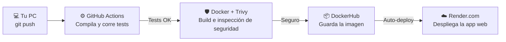

# Práctica DevOps: CI/CD, DevSecOps y Containerization

Esta práctica cubre el ciclo completo de DevOps moderno utilizando el proyecto **"libros"** ([dds-deploy](https://github.com/ezequieljsosa/dds-deploy)) como referencia: desde la containerización optimizada (*Multi-stage builds*), pruebas de salud (*Healthcheck*), integración y entrega continua (CI/CD) con taggeo automático de versiones (`sha` / `semver`), escaneo de vulnerabilidades (DevSecOps) y despliegue continuo en **Render.com**.

---

## 🗺️¿Cómo funciona el Pipeline de CI/CD?

Antes de empezar con los pasos prácticos, es fundamental entender el viaje que hace tu código desde que lo escribes en tu computadora hasta que está funcionando en internet.

### Explicación simple del flujo:
1. **Integración Continua (CI):** Cada vez que subes un cambio (`git push`), **GitHub Actions** descarga tu código y ejecuta automáticamente los tests (`mvn clean test`). Si un test falla, el proceso se detiene y te avisa para que no subas código roto.
2. **Seguridad y Construcción (DevSecOps):** Si los tests pasan, GitHub construye la imagen de **Docker** optimizada y la escanea con **Trivy** para asegurarse de que no tenga vulnerabilidades de seguridad conocidas.
3. **Entrega y Despliegue Continuo (CD):** Finalmente, sube la imagen etiquetada a **DockerHub** y le avisa a **Render.com** para que actualice la aplicación en la nube de forma automática sin caída de servicio.

### Diagrama del flujo:



---

## Etapa 1: Pasos manuales, Multi-stage Builds y Healthchecks

En esta etapa revisaremos el repositorio y aprenderemos a crear una imagen de Docker optimizada para producción usando **Multi-stage builds** e incorporando un **Healthcheck** nativo.

### 1. Fork y Clone

Hacer un Fork del repositorio [dds-deploy](https://github.com/ezequieljsosa/dds-deploy) en tu cuenta de GitHub (o verificar tu clone si ya lo realizaste previamente):

```bash
git clone https://github.com/[su_user]/dds-deploy.git
cd dds-deploy
```

### 2. Ejecutar tests localmente (Java 21 LTS)

Para verificar que el proyecto compila y los tests pasan usando Java 21:

```bash
mvn clean test
```

### 3. Multi-stage Dockerfile con Healthcheck

Utilizaremos un **Multi-stage Dockerfile** para separar la compilación del runtime y agregaremos la instrucción **`HEALTHCHECK`**. Esto permite que Docker (y orquestadores como Render o Kubernetes) monitoreen continuamente si la aplicación está respondiendo correctamente en runtime y no solo si el proceso de Java inició.

Crea o actualiza el archivo `Dockerfile` en la raíz de tu proyecto:

```dockerfile
# --- Stage 1: Build (Compilación y Empaquetado) ---
FROM maven:3.9-eclipse-temurin-21-alpine AS builder
WORKDIR /app

# Copiamos primero el pom.xml para aprovechar el cache de dependencias
COPY pom.xml .
RUN mvn dependency:go-offline

# Copiamos el código fuente y compilamos el JAR
COPY src ./src
RUN mvn clean package -DskipTests

# --- Stage 2: Runtime (Entorno de Ejecución Liviano y Seguro) ---
FROM eclipse-temurin:21-jre-alpine
WORKDIR /app

# Instalamos curl para permitir la verificación de salud del Healthcheck
RUN apk add --no-cache curl

# Copiamos únicamente el artefacto compilado desde el Stage 1
COPY --from=builder /app/target/*.jar app.jar

EXPOSE 8080

# --- Healthcheck Nativo de Docker ---
# Verifica cada 30s que el endpoint /libros responda HTTP 200 OK
HEALTHCHECK --interval=30s --timeout=5s --start-period=40s --retries=3 \
  CMD curl -f http://localhost:8080/libros || exit 1

ENTRYPOINT ["java", "-jar", "app.jar"]
```

Construye la imagen optimizada localmente:

```bash
docker build -t ddsdeploy:v1 .
```

### 4. Levantar y verificar la salud del contenedor

Prueba tu contenedor ejecutándolo en local:

```bash
docker compose up -d
```

- Para verificar que la aplicación responde ingresa a: `http://localhost:8080/libros`
- Inspecciona el estado de salud del contenedor ejecutando `docker ps`. Verás la etiqueta **`(healthy)`** al lado del puerto `8080`.

---

## Etapa 2: Despliegue en un PaaS - Render.com

**PaaS** (Plataforma como Servicio) brinda un entorno completo para ejecutar aplicaciones sin gestionar la infraestructura subyacente. Utilizaremos **Render.com** para el despliegue automático del contenedor y de la base de datos PostgreSQL.

### 1. Crear la base de datos PostgreSQL

1. Entra a [render.com](https://render.com) e inicia sesión.
2. Haz clic en el botón **"New +"** (arriba a la derecha) y selecciona **"PostgreSQL"**.
3. Asigna un nombre a la DB, selecciona el plan **Free** y presiona **Create Database**.
4. Una vez creada, copia el valor de **"External Database URL"** (útil para clientes como **DBeaver**) y toma nota del **Hostname** e **Internal Database URL**.

### 2. Crear el Web Service en Render

1. Haz clic en **"New +"** y selecciona **"Web Service"**.
2. Conecta tu cuenta de GitHub y selecciona tu repositorio `dds-deploy`.
3. Configura los campos del Web Service:
   - **Name**: `dds-deploy-tuusuario`
   - **Runtime**: **Docker**
   - **Instance Type**: **Free**
   - **Dockerfile Path**: `./Dockerfile`

### 3. Configurar Variables de Entorno

En la pestaña **Environment** de tu Web Service en Render, agrega las siguientes variables para vincular la aplicación con la base de datos sin hardcodear credenciales en Git:

| Variable | Valor |
|---|---|
| `javax__persistence__jdbc__driver` | `org.postgresql.Driver` |
| `javax__persistence__jdbc__password` | *(contraseña provista por la DB en Render)* |
| `javax__persistence__jdbc__url` | `jdbc:postgresql://[database_host]/[database_name]` |
| `javax__persistence__jdbc__user` | *(usuario provisto por la DB en Render)* |
| `hibernate__hbm2ddl__auto` | `create` |

> **Nota importante:** El `database_host` debe ser el Hostname interno de Render. La URL debe comenzar obligatoriamente con `jdbc:postgresql://`.

---

## Etapa 3: Integración Continua (CI) con GitHub Actions

Cada vez que hagamos un `push` o abramos un `Pull Request`, GitHub ejecutará un Workflow automático que compilará el proyecto con Java 21 LTS y correrá la suite de tests unitarios.

### 1. Crear el Workflow de CI

Crea la estructura de carpetas `.github/workflows/` en la raíz de tu repositorio y agrega el archivo `ci.yml`:

```yaml
name: Continuous Integration (CI)

on:
  push:
    branches: [ "main", "master" ]
  pull_request:
    branches: [ "main", "master" ]

jobs:
  test:
    name: Build & Run Tests (Java 21)
    runs-on: ubuntu-latest

    steps:
      - name: Checkout del código
        uses: actions/checkout@v4

      - name: Configurar JDK 21
        uses: actions/setup-java@v4
        with:
          java-version: '21'
          distribution: 'temurin'
          cache: maven

      - name: Compilar y ejecutar pruebas con Maven
        run: mvn clean test
```

### 2. Probar y Verificar el Pipeline de CI en GitHub

1. **Subir los cambios a GitHub:**
   ```bash
   git add .github/workflows/ci.yml
   git commit -m "ci: agregar workflow de integración continua"
   git push origin main
   ```

2. **¿Dónde ver los resultados del Workflow?**
   - Ingresa a tu repositorio en GitHub y haz clic en la pestaña superior **Actions**.
   - En el menú izquierdo verás la lista de Workflows; selecciona **Continuous Integration (CI)**.
   - Haz clic en la ejecución más reciente (identificada con el mensaje de tu commit).
   - Haz clic en el Job **Build & Run Tests (Java 21)** para ver la consola de salida en tiempo real. Allí podrás desplegar el paso **Compilar y ejecutar pruebas con Maven** y observar el reporte de JUnit (`Tests run: 1, Failures: 0, Errors: 0`).

3. **Prueba de fallo (Validación de bloqueo):**
   - Modifica temporalmente un test en `AppLibrosTest` para forzar un fallo (por ejemplo `assertEquals(1, 2);`).
   - Sube los cambios con `git commit` y `git push`.
   - Vuelve a la pestaña **Actions**: observarás que la ejecución se torna de color rojo ❌.
   - En los Pull Requests abiertos hacia `main`, verás un aviso que indica *"Checks have failed"*, impidiendo la integración de código roto.
   - Corrige el test, realiza un nuevo `push` y confirma que el indicador vuelva a estar en verde (PASSED) ✅.

---

## Etapa 4: Entrega Continua (CD), Tags Dinámicos y DevSecOps

En esta etapa automatizaremos la construcción y etiquetado de imágenes Docker utilizando **Tags Dinámicos** (versión por hash del commit `${{ github.sha }}` y `:latest`), análisis de seguridad con **Trivy** y publicación en **DockerHub**.

### 1. Configurar Secrets en GitHub

Para no exponer credenciales sensibles en el código, agrega tus claves como Secrets:

1. En tu repositorio de GitHub, ve a **Settings → Secrets and variables → Actions**.
2. Haz clic en **New repository secret** y agrega:
   - `DOCKERHUB_USERNAME`: Tu nombre de usuario en DockerHub.
   - `DOCKERHUB_TOKEN`: Tu Personal Access Token de DockerHub (generado desde *DockerHub → Account Settings → Personal Access Tokens*).

### 2. Crear el Workflow de CD + DevSecOps con Taggeo de Versiones

Crea el archivo `.github/workflows/cd.yml` en tu repositorio:

```yaml
name: Continuous Deployment (CD) & DevSecOps

on:
  push:
    branches: [ "main", "master" ]

jobs:
  build-scan-push:
    name: DevSecOps Scan & Docker Push
    runs-on: ubuntu-latest

    steps:
      - name: Checkout del código
        uses: actions/checkout@v4

      - name: Configurar Docker Buildx
        uses: docker/setup-buildx-action@v3

      - name: Iniciar sesión en DockerHub
        uses: docker/login-action@v3
        with:
          username: ${{ secrets.DOCKERHUB_USERNAME }}
          password: ${{ secrets.DOCKERHUB_TOKEN }}

      # --- Gestión Profesional de Tags (SemVer / Commit SHA / latest) ---
      - name: Extraer metadatos para Docker Tags
        id: meta
        uses: docker/metadata-action@v5
        with:
          images: ${{ secrets.DOCKERHUB_USERNAME }}/ddsdeploy
          tags: |
            type=raw,value=latest,enable=${{ github.ref == 'refs/heads/main' }}
            type=sha,format=short,prefix=commit-

      - name: Construir imagen Docker para escaneo
        run: |
          docker build -t ${{ secrets.DOCKERHUB_USERNAME }}/ddsdeploy:${{ github.sha }} .

      # --- DevSecOps: Escaneo de Vulnerabilidades con Trivy ---
      - name: Escaneo de Seguridad con Trivy
        uses: aquasecurity/trivy-action@master
        with:
          image-ref: '${{ secrets.DOCKERHUB_USERNAME }}/ddsdeploy:${{ github.sha }}'
          format: 'table'
          exit-code: '0'
          severity: 'CRITICAL,HIGH'

      # --- CD: Publicación con Tags Dinámicos ---
      - name: Build & Push a DockerHub con múltiplos Tags
        uses: docker/build-push-action@v5
        with:
          context: .
          push: true
          tags: ${{ steps.meta.outputs.tags }}
          labels: ${{ steps.meta.outputs.labels }}
```

### 3. Verificación de los Resultados del Pipeline Completo

Una vez enviado el workflow a GitHub (`git push`), verifica cada plataforma involucrada:

1. **En GitHub Actions:**
   - Ve a **Actions → Continuous Deployment (CD) & DevSecOps**.
   - Abre el paso **Escaneo de Seguridad con Trivy** en la consola: allí verás la matriz que analiza paquetes del sistema operativo e imágenes buscando vulnerabilidades conocidas (CVEs).

2. **En DockerHub:**
   - Ingresa a tu cuenta de [hub.docker.com](https://hub.docker.com) y selecciona tu repositorio `ddsdeploy`.
   - Haz clic en la pestaña **Tags**: comprobarás que se generaron dos etiquetas simultáneas para el mismo push:
     - `:latest` (la versión activa para producción).
     - `:commit-a1b2c3d` (identificador único vinculado al hash del commit de Git).

3. **En Render.com:**
   - Si tu Web Service en Render tiene configurado el desplegamiento automático (*Auto-Deploy: Yes*), ingresa al Dashboard de Render.
   - En la sección **Events** / **Logs** del servicio, verás la entrada *"Deploying image from GitHub push"* donde Render detecta la nueva imagen y la despliega automáticamente en tu servidor cloud.

---

## 📌 Badges de Estado para el README

Como buena práctica profesional, puedes agregar badges dinámicos al `README.md` de tu repositorio para mostrar el estado del pipeline en tiempo real. 

Agrega estas líneas al inicio de tu `README.md`:

```markdown


```

---

## Resumen de Aprendizajes Prácticos

1. **Multi-stage Builds & Healthcheck:** Creación de imágenes livianas con monitoreo nativo mediante `curl` y `HEALTHCHECK`.
2. **CI con GitHub Actions:** Automatización de compilación y ejecución de tests en Java 21 LTS.
3. **DevSecOps con Trivy:** Inspección automática de vulnerabilidades conocidas (CVEs) en la imagen antes de publicar.
4. **Taggeo Dinámico de Contenedores:** Buenas prácticas de versión en DockerHub (`:latest` y `:commit-sha`).
5. **PaaS Auto-Deploy:** Verificación de trazas y despliegue continuo en Render.com.
