# Práctica de MLOps: Ciclo de Vida Completo de Machine Learning

Esta guía te llevará paso a paso a través de la implementación práctica de un pipeline de **MLOps (Machine Learning Operations)** end-to-end. Construiremos un sistema de predicción de **Cancelación de Clientes (Telco Customer Churn)** pasando por las 5 etapas clave del ciclo de vida:

1. **Versionado de Datos**: Con **DVC (Data Version Control)** y Git.
2. **Tracking de Experimentos y Registro**: Con **MLflow Server**.
3. **Servido en Tiempo Real**: Creando un microservicio REST en **FastAPI** empaquetado en **Docker** utilizando **Pipelines de Scikit-Learn**.
4. **Monitoreo de Data Drift**: Evaluando la degradación del modelo con **Evidently AI**.

---

### 🌐 Arquitectura de la Práctica

```mermaid
graph LR
    Dataset["1. churn.csv (DVC)"] --> Train["2. Train Pipeline (Sklearn)"]
    Train --> MLflow["3. MLflow Server (--serve-artifacts)"]
    MLflow --> Registry["4. Model Registry (Production)"]
    Registry --> API["5. FastAPI + Docker (Port 8000)"]
    API --> Drift["6. Monitoreo Data Drift (Evidently)"]

    style Dataset fill:#0f172a,stroke:#38bdf8,stroke-width:1px,color:#fff
    style Train fill:#0f172a,stroke:#818cf8,stroke-width:1px,color:#fff
    style MLflow fill:#0f172a,stroke:#c084fc,stroke-width:1px,color:#fff
    style Registry fill:#0f172a,stroke:#f472b6,stroke-width:1px,color:#fff
    style API fill:#0f172a,stroke:#34d399,stroke-width:1px,color:#fff
    style Drift fill:#0f172a,stroke:#fbbf24,stroke-width:1px,color:#fff
```



---

## 📚 Módulo Didáctico: Glosario de Herramientas de la Práctica

Antes de comenzar la ejecución de comandos, revisemos el rol que cumple cada tecnología en el ecosistema MLOps:

| Herramienta | ¿Qué es? | Rol en este Laboratorio | ¿Por qué la usamos? |
| :--- | :--- | :--- | :--- |
| **DVC (Data Version Control)** | Sistema open-source para versionar datos y modelos como si fueran código Git. | Rastrea cambios en `churn.csv` sin subir megabytes pesados a Git. | Evita saturar repositorios Git con binarios y garantiza reproducibilidad de datasets. |
| **MLflow Server** | Plataforma para gestionar el ciclo de vida de ML (Tracking, Registry, Artifacts). | Almacena métricas (`accuracy`, `f1`), hiperparámetros y gestiona versiones del modelo (`ChurnModel/1`). | Permite auditar qué código/parámetros generaron el mejor modelo y promover a producción. |
| **Scikit-Learn Pipeline** | Ensamblador de transformaciones de datos y algoritmos de estimación. | Une el preprocesamiento (`OneHotEncoder`) con el clasificador (`RandomForestClassifier`). | Evita la fuga de datos (*Data Leakage*) y permite que la API reciba datos crudos del usuario. |
| **FastAPI** | Framework Python web moderno y ultrarrápido para construir APIs REST. | Expone el endpoint HTTP `POST /predict` en tiempo real. | Provee serialización automática con Pydantic, alta concurrencia y documentación Swagger. |
| **Docker & Docker Compose** | Placa de virtualización por contenedores ligeros. | Aísla el servidor MLflow y el microservicio de inferencia en contenedores portables. | Elimina el problema "en mi computadora funciona" garantizando ejecuciones idénticas. |
| **Evidently AI** | Librería de observabilidad y evaluación de modelos de ML en producción. | Compara los datos de entrenamiento con datos simulados en producción para detectar **Data Drift**. | Alerta cuando la realidad cambia y el modelo requiere re-entrenamiento (CT). |

---

## 🛠️ Requisitos Previos

Asegúrate de contar con las siguientes herramientas en tu sistema:
- **Python 3.12** (recomendado) y `pip` — en WSL/Ubuntu, si no lo tenés instalado, la Etapa 0 te indica cómo instalarlo
- **Docker** y **Docker Compose**
- **Git**

---

## Etapa 0: Preparación del Proyecto y Entorno

1. Crea y posicionate en el **directorio de trabajo único** para toda la práctica:
```bash
mkdir -p $HOME/practica-mlops && cd $HOME/practica-mlops
git init
```
> [!IMPORTANT]
> **Espacio de Trabajo Único (`$HOME/practica-mlops`)**:
> Todos los comandos, archivos (`requirements.txt`, `docker-compose.yml`, `train.py`, `app.py`, `monitor_drift.py`) y configuraciones de Git/DVC de las Etapas 0 a 4 deben crearse y ejecutarse **dentro de este mismo directorio**. Asegúrate de mantener tu terminal abierta en este path.

2. Crea el archivo de dependencias de Python `requirements.txt` con versiones fijadas para garantizar reproducibilidad:
```text
pandas==2.2.1
scikit-learn==1.4.1post1
mlflow==2.11.3
dvc==3.48.0
pathspec==0.11.2  # dvc 3.48.0 no soporta pathspec>=1.0 (rompe "dvc init")
fastapi==0.110.0
uvicorn==0.28.0
requests==2.31.0
evidently>=0.4.3
pydantic>=2.6.4
setuptools<70.0.0
```

3. Crea y activa un **entorno virtual (venv) con Python 3.12** exclusivo para esta práctica. Esto evita conflictos con paquetes ya instalados en tu sistema (o el error `externally-managed-environment` en distribuciones Linux recientes):
```bash
python3.12 -m venv venv
source venv/bin/activate
```
> [!NOTE]
> **¿Por qué `python3.12` y no `python3` a secas?** Las versiones de `requirements.txt` están fijadas desde 2024 (`pandas==2.2.1`, `scikit-learn==1.4.1post1`, etc.) para garantizar reproducibilidad. Si tu `python3` default apunta a una versión más nueva (3.13, 3.14...), `pip` no encuentra un paquete precompilado (*wheel*) para esas versiones viejas y trata de compilarlas desde código fuente — ahí es donde suelen aparecer errores largos de `meson`/`pkg-config` al instalar `pandas`. Python 3.12 sí tiene wheels para todas las dependencias de esta guía.

> [!WARNING]
> **Error `The virtual environment was not created successfully because ensurepip is not available`** (típico en WSL/Ubuntu recién instalado): falta el paquete `python3.12-venv`. Como en WSL sos administrador de tu propia distro, resolvelo con:
> ```bash
> sudo apt update
> sudo apt install -y python3.12 python3.12-venv
> ```
> Después volvé a ejecutar `python3.12 -m venv venv` y `source venv/bin/activate`.

> [!IMPORTANT]
> **Recordá activar el venv en cada terminal nueva**: si cerrás la terminal o abrís una nueva pestaña, debés volver a ejecutar `source venv/bin/activate` (desde `$HOME/practica-mlops`) antes de correr cualquier comando `python`, `pip` o `dvc` de esta guía. Si ves `(venv)` al inicio de tu prompt, está activo.

4. Instala las dependencias dentro del venv activado:
```bash
pip install -r requirements.txt
```

5. Levanta el servidor de **MLflow** en un contenedor Docker utilizando `docker-compose.yml`:

Crea el archivo `docker-compose.yml`:
```yaml
version: '3.8'

services:
  mlflow:
    image: ghcr.io/mlflow/mlflow:v2.11.3
    container_name: mlflow_server
    ports:
      - "5000:5000"
    volumes:
      - mlflow_db:/mlflow
    command: mlflow server --host 0.0.0.0 --port 5000 --backend-store-uri sqlite:////mlflow/mlflow.db --default-artifact-root /mlflow/artifacts --serve-artifacts

volumes:
  mlflow_db:
```

Levanta el servicio:
```bash
docker compose up -d
```
> 📌 **Verificación**: Ingresa a tu navegador en `http://localhost:5000` para confirmar que la interfaz de MLflow está lista.

---

## Etapa 1: Ingesta y Versionado de Datos con DVC

### 📥 Entradas y Salidas de la Etapa 1
- **Entrada (Input):** URL pública del dataset `Telco-Customer-Churn.csv` en crudo.
- **Proceso:** Inicialización de DVC, asignación de storage remoto local e ingesta con `dvc add`.
- **Salida (Output):** Archivo de metadatos `data/churn.csv.dvc` (rastreado en Git) y archivo binario guardado en el remoto `$HOME/dvc-storage`.

> [!NOTE]
> **¿Por qué usamos DVC junto a Git?**
> Git está diseñado para código fuente (texto). Si guardamos datasets pesados en Git, los repositorios se vuelven extremadamente lentos. DVC crea un archivo pequeño de metadatos (ej: `churn.csv.dvc`) que rastrea la versión exacta del dataset, mientras que el archivo real se almacena en un almacenamiento externo. Para esta práctica, simularemos un almacenamiento en la nube usando una carpeta local.

1. Inicializa DVC y configura un almacenamiento remoto local:
```bash
dvc init
mkdir -p $HOME/dvc-storage
dvc remote add -d localremote $HOME/dvc-storage
```

2. Descarga el dataset oficial de **Telco Customer Churn**:
```bash
mkdir -p data
curl -sL "https://raw.githubusercontent.com/IBM/telco-customer-churn-on-icp4d/master/data/Telco-Customer-Churn.csv" -o data/churn.csv
```

3. Agrega el dataset al control de DVC:
```bash
dvc add data/churn.csv
```
*Esto creará el archivo `data/churn.csv.dvc` y agregará `data/churn.csv` al `.gitignore`.*

4. Guarda el puntero en Git y sincroniza con DVC:
```bash
git add data/churn.csv.dvc data/.gitignore .dvc/config
git commit -m "feat: Ingesta y versionado inicial de dataset churn v1.0"
dvc push
```

### ❓ Preguntas de Cierre — Etapa 1

- **P1:** Agregás 500 filas nuevas al dataset y corrés `dvc add`, `git commit` y `dvc push`. Un compañero hace `git pull`, entrena, y obtiene **métricas distintas a las tuyas**. ¿Qué versión del dataset usó y qué comando le faltó ejecutar?
- **P2:** En esta práctica el remoto DVC es una carpeta en `$HOME`. Si trabajaran 5 personas desde máquinas distintas, ¿qué habría que cambiar? ¿Por qué el archivo `.dvc` versionado en Git seguiría funcionando exactamente igual?

<details>
<summary>Ver respuestas orientativas</summary>

- **P1:** Usó el dataset **viejo**, el que ya tenía en su disco. `git pull` le trajo el `.dvc` actualizado (el puntero con el hash nuevo), pero **no** el archivo real — ese vive en el remoto DVC, que es un canal de sincronización totalmente separado de Git. Le faltó `dvc pull`. Esta es la idea central de la etapa: **Git y DVC son dos flujos independientes**, y hay que sincronizar los dos.
- **P2:** Habría que reemplazar el remoto local por uno accesible en red: S3, MinIO, Google Cloud Storage, Azure Blob o incluso SSH — se cambia con `dvc remote add`, y queda registrado en `.dvc/config`. Lo importante es que el `.dvc` **no cambia**: guarda el *hash del contenido*, no la ubicación física. Por eso el mismo puntero sirve sin importar dónde esté guardado el archivo — exactamente el mismo principio por el que un `docker pull` funciona igual contra Docker Hub o contra un registry privado.

</details>

---

## Etapa 2: Entrenamiento y Tracking de Experimentos con MLflow

### 📥 Entradas y Salidas de la Etapa 2
- **Entrada (Input):** Dataset `data/churn.csv` (7043 registros) versionado en la Etapa 1.
- **Proceso:** División train/test (80/20), ajuste de hiperparámetros (`n_estimators=100`, `max_depth=8`) y entrenamiento del `Pipeline` completo (`ColumnTransformer` + `RandomForestClassifier`).
- **Salida (Output):** Registro de métricas (`accuracy`, `f1_score`) en MLflow y exportación del modelo registrado `ChurnModel` (versión 1) en el Registry.

Para evitar la inconsistencia de datos (*Data Leakage*) entre el entrenamiento y producción, utilizaremos un **`Pipeline` de Scikit-Learn** que empaqueta las transformaciones de datos (`ColumnTransformer` + `OneHotEncoder`) junto con el modelo (`RandomForestClassifier`).

Crea el archivo `train.py`:

```python
import os
import pandas as pd
import mlflow
import mlflow.sklearn
from sklearn.model_selection import train_test_split
from sklearn.ensemble import RandomForestClassifier
from sklearn.compose import ColumnTransformer
from sklearn.preprocessing import OneHotEncoder, StandardScaler
from sklearn.pipeline import Pipeline
from sklearn.metrics import accuracy_score, f1_score

# Configurar servidor de MLflow
mlflow.set_tracking_uri(os.getenv("MLFLOW_TRACKING_URI", "http://localhost:5000"))
mlflow.set_experiment("Telco-Churn-Prediction")

print("📥 Cargando dataset...")
df = pd.read_csv("data/churn.csv")

# Preprocesamiento de limpieza inicial
df['TotalCharges'] = pd.to_numeric(df['TotalCharges'], errors='coerce').fillna(0)
df['Churn'] = df['Churn'].apply(lambda x: 1 if x == 'Yes' else 0)

X = df.drop(columns=['customerID', 'Churn'])
y = df['Churn']

categorical_cols = X.select_dtypes(include=['object']).columns.tolist()
numeric_cols = X.select_dtypes(include=['int64', 'float64']).columns.tolist()

# Definir transformador de columnas
preprocessor = ColumnTransformer(
    transformers=[
        ('num', StandardScaler(), numeric_cols),
        ('cat', OneHotEncoder(handle_unknown='ignore'), categorical_cols)
    ]
)

# Empaquetar preprocesamiento y modelo en un Pipeline inmutable
pipeline = Pipeline(steps=[
    ('preprocessor', preprocessor),
    ('classifier', RandomForestClassifier(n_estimators=100, max_depth=8, random_state=42))
])

X_train, X_test, y_train, y_test = train_test_split(X, y, test_size=0.2, random_state=42)

with mlflow.start_run():
    print("🧠 Entrenando Pipeline completo (Transformaciones + Modelo)...")
    pipeline.fit(X_train, y_train)

    predictions = pipeline.predict(X_test)
    acc = accuracy_score(y_test, predictions)
    f1 = f1_score(y_test, predictions)

    print(f"📊 Métricas: Accuracy = {acc:.4f} | F1-Score = {f1:.4f}")

    # Registrar Parámetros y Métricas
    mlflow.log_param("n_estimators", 100)
    mlflow.log_param("max_depth", 8)
    mlflow.log_metric("accuracy", acc)
    mlflow.log_metric("f1_score", f1)

    # Loguear y registrar el Pipeline completo en el Registry
    mlflow.sklearn.log_model(
        sk_model=pipeline,
        artifact_path="model",
        registered_model_name="ChurnModel"
    )

print("✅ Entrenamiento completado. Revisa http://localhost:5000")
```

Ejecuta el script:
```bash
python train.py
```

> 📌 **Verificación en MLflow**: 
> 1. Abre `http://localhost:5000`.
> 2. Haz clic en el experimento `Telco-Churn-Prediction` para ver las métricas del Run.
> 3. Entra al menú **Models** arriba a la izquierda y verás el modelo registrado `ChurnModel` en versión 1.

### ❓ Preguntas de Cierre — Etapa 2

- **P1:** Dentro de 6 meses te piden **reproducir exactamente** el modelo `ChurnModel/1`. Mirá qué está logueando `train.py` hoy: ¿te alcanzaría? ¿Qué información crítica falta registrar?
- **P2:** ¿Qué problema evitás al registrar el `Pipeline` completo (transformaciones + modelo) en lugar de sólo el `RandomForestClassifier` entrenado? Pensalo en términos de qué datos recibe `app.py` en el endpoint `/predict`.

<details>
<summary>Ver respuestas orientativas</summary>

- **P1:** **No alcanzaría.** Hoy `train.py` loguea los hiperparámetros (`n_estimators`, `max_depth`) y las métricas (`accuracy`, `f1_score`), pero no deja rastro de las otras dos patas de la reproducibilidad: **qué versión del código** generó el modelo (el commit de Git) y **qué versión de los datos** se usó (el hash del `.dvc` de la Etapa 1). Sin eso podés saber *qué resultado* diste, pero no podés volver a producirlo. Se resolvería agregando algo como `mlflow.log_param("git_commit", ...)` y `mlflow.log_artifact("data/churn.csv.dvc")`. Ésta es la razón por la que MLOps insiste en versionar **código + datos + modelo** juntos: las tres cosas o ninguna.
- **P2:** Evitás el **training-serving skew**. Si registraras sólo el clasificador, el preprocesamiento (`StandardScaler` + `OneHotEncoder`) habría que reimplementarlo a mano dentro de `app.py`, y cualquier diferencia mínima (orden de columnas, una categoría nueva, otro criterio de escalado) haría que el modelo reciba en producción datos procesados distinto que en entrenamiento — y falle **en silencio**, sin lanzar ningún error, simplemente prediciendo mal. Al empaquetar todo en el `Pipeline`, la API puede recibir el JSON crudo del negocio (`"Contract": "Month-to-month"`) y las transformaciones se aplican solas, garantizadamente iguales a las del entrenamiento.

</details>

---

## Etapa 3: Servido del Modelo mediante una API REST (FastAPI + Docker)

### 📥 Entradas y Salidas de la Etapa 3
- **Entrada (Input):** Petición HTTP `POST /predict` con un JSON que contiene las 19 características crudas del cliente (`gender`, `Contract`, `MonthlyCharges`, etc.).
- **Proceso:** Carga dinámica del Pipeline `models:/ChurnModel/1` desde MLflow Server y ejecución de la inferencia en tiempo real.
- **Salida (Output):** Respuesta JSON con la predicción (`churn_prediction`: 0 o 1), probabilidad estimada y estado legible (`"Will Churn"` / `"Will Stay"`).

Crearemos un microservicio con **FastAPI** que descargará el Pipeline registrado desde MLflow y ofrecerá un endpoint HTTP `POST /predict`. Gracias al Pipeline, la API puede recibir datos crudos del negocio (strings en lugar de números codificados).

1. Crea el archivo `app.py`:

```python
import os
import pandas as pd
import mlflow.sklearn
from fastapi import FastAPI, HTTPException
from pydantic import BaseModel

# Conectar a MLflow leyendo variable de entorno o fallback local
tracking_uri = os.getenv("MLFLOW_TRACKING_URI", "http://localhost:5000")
mlflow.set_tracking_uri(tracking_uri)

app = FastAPI(title="Telco Churn Prediction API")

# Cargar la versión 1 del Pipeline registrado
model_uri = os.getenv("MODEL_URI", "models:/ChurnModel/1")
try:
    print(f"📦 Cargando Pipeline desde {model_uri}...")
    model = mlflow.sklearn.load_model(model_uri)
except Exception as e:
    print(f"❌ Error al cargar modelo: {e}")
    model = None

class CustomerFeatures(BaseModel):
    gender: str
    SeniorCitizen: int
    Partner: str
    Dependents: str
    tenure: int
    PhoneService: str
    MultipleLines: str
    InternetService: str
    OnlineSecurity: str
    OnlineBackup: str
    DeviceProtection: str
    TechSupport: str
    StreamingTV: str
    StreamingMovies: str
    Contract: str
    PaperlessBilling: str
    PaymentMethod: str
    MonthlyCharges: float
    TotalCharges: float

@app.post("/predict")
def predict_churn(customer: CustomerFeatures):
    if model is None:
        raise HTTPException(status_code=503, detail="Modelo no disponible")
    
    input_data = customer.model_dump() if hasattr(customer, 'model_dump') else customer.dict()
    data = pd.DataFrame([input_data])
    
    prediction = model.predict(data)[0]
    probability = float(model.predict_proba(data)[0][1])
    
    return {
        "churn_prediction": int(prediction),
        "churn_probability": round(probability, 4),
        "status": "Will Churn" if prediction == 1 else "Will Stay"
    }

# Endpoint de salud (Utilizado por las sondas de Kubernetes Liveness/Readiness Probe)
@app.get("/health")
def health():
    return {"status": "ok", "model_loaded": model is not None}
```

2. Crea un `Dockerfile` para empaquetar la API:

```dockerfile
FROM python:3.9-slim

WORKDIR /app

COPY requirements.txt .
RUN pip install --no-cache-dir -r requirements.txt

COPY app.py .

EXPOSE 8000

CMD ["uvicorn", "app:app", "--host", "0.0.0.0", "--port", "8000"]
```

3. Construye y ejecuta el contenedor Docker de la API:

```bash
docker build -t churn-api:v1 .

docker run -d --name churn_api_service \
  -p 8000:8000 \
  -v /mlflow:/mlflow \
  -e MLFLOW_TRACKING_URI="http://host.docker.internal:5000" \
  --add-host=host.docker.internal:host-gateway \
  churn-api:v1
```

4. **Prueba de Inferencia con `curl`** (enviando cadenas reales del cliente):

```bash
curl -X 'POST' \
  'http://localhost:8000/predict' \
  -H 'Content-Type: application/json' \
  -d '{
  "gender": "Female",
  "SeniorCitizen": 0,
  "Partner": "Yes",
  "Dependents": "No",
  "tenure": 1,
  "PhoneService": "No",
  "MultipleLines": "No phone service",
  "InternetService": "DSL",
  "OnlineSecurity": "No",
  "OnlineBackup": "Yes",
  "DeviceProtection": "No",
  "TechSupport": "No",
  "StreamingTV": "No",
  "StreamingMovies": "No",
  "Contract": "Month-to-month",
  "PaperlessBilling": "Yes",
  "PaymentMethod": "Electronic check",
  "MonthlyCharges": 29.85,
  "TotalCharges": 29.85
}'
```

*Respuesta esperada* (verificado con las versiones pineadas de `requirements.txt`; si te da un `churn_probability` levemente distinto por diferencias de plataforma no es un error, pero `churn_prediction` y `status` deberían coincidir):
```json
{
  "churn_prediction": 0,
  "churn_probability": 0.4926,
  "status": "Will Stay"
}
```

### ❓ Preguntas de Cierre — Etapa 3

- **P1:** `app.py` carga el modelo con `models:/ChurnModel/1`, una **versión fija**. Si entrenás una versión 2 mejor, ¿qué habría que hacer para que la API la empiece a usar? ¿Qué riesgo tendría apuntar directamente al stage `Production` en lugar de a un número fijo?
- **P2:** Hacés `GET /health` y devuelve `model_loaded: false`. Enumerá **tres** causas posibles, ordenadas de más a menos probable.

<details>
<summary>Ver respuestas orientativas</summary>

- **P1:** Con una versión fija hay que **cambiar el código (o la variable de entorno `MODEL_URI`) y redesplegar** el contenedor — es explícito y predecible, pero lento. Apuntar a `models:/ChurnModel/Production` haría que la API tome automáticamente el modelo que esté promovido a ese stage en el Registry, sin tocar código; el riesgo es que **cualquiera que promueva un modelo en MLflow cambia producción al instante**, sin revisión, sin PR y sin posibilidad de rollback controlado. En un entorno serio ese cambio no se hace de golpe sino con las estrategias que vimos en teoría: *shadow testing* primero (el modelo nuevo recibe tráfico real pero su respuesta no se devuelve a nadie) y después *canary* (un 5% del tráfico real), monitoreando antes de escalar al 100%.
- **P2:** En orden de probabilidad: **(1)** la API no llega al servidor MLflow — mal `MLFLOW_TRACKING_URI`, contenedor sin `host.docker.internal`, o MLflow caído; **(2)** el modelo `ChurnModel` versión 1 no existe todavía en el Registry, porque `train.py` nunca se corrió exitosamente; **(3)** MLflow responde pero no puede entregar el artefacto binario (falta `--serve-artifacts`, o el volumen de artefactos no es accesible desde el contenedor de la API). El primer lugar donde mirar siempre es `docker logs churn_api_service`, porque `app.py` imprime el error exacto al fallar la carga.

</details>

---

## Etapa 4: Monitoreo de Data Drift con Evidently AI

### 📥 Entradas y Salidas de la Etapa 4
- **Entrada (Input):** Dataset de referencia `data/churn.csv` (entrenamiento) y lote de producción con datos simulados alterados.
- **Proceso:** Evaluación estadística de la divergencia de distribuciones (KS-Test / Wasserstein Distance) sobre las características numéricas principales.
- **Salida (Output):** Reporte visual interactivo generado en archivo HTML (`drift_report.html`).

Un modelo entrenado es una **foto de una relación estadística** tomada en un momento del tiempo. Cuando el mundo real se mueve y esa foto queda vieja, el modelo empieza a fallar **sin que nadie haya tocado una línea de código**. A eso lo llamamos **drift**, y es la razón por la que el ciclo de vida de ML es circular (entrenar → desplegar → monitorear → re-entrenar) y no lineal como un deploy de software tradicional.

En un sistema productivo real, los "datos actuales" saldrían de los logs de predicciones de la API que construimos en la Etapa 3. Como en este laboratorio todavía no acumulamos tráfico real, vamos a **simular** ese lote de producción deformando a propósito dos columnas del dataset original:

| Columna | Qué le hacemos | Qué situación del mundo real simula |
| :--- | :--- | :--- |
| `MonthlyCharges` | La multiplicamos por **1.8** (+80%) | Un aumento de tarifas o un salto inflacionario |
| `tenure` | La multiplicamos por **0.3** (-70%) | Una ola de clientes nuevos (campaña de captación) |
| `SeniorCitizen` | **No la tocamos** | Grupo de control del experimento |

> [!IMPORTANT]
> **Prestá atención a `SeniorCitizen`**: la dejamos intacta a propósito. Es el **control** del experimento — si Evidently marcara drift en una columna que no modificamos, significaría que el análisis no es confiable. Al terminar deberías ver drift en las dos columnas alteradas y **cero** en esta.

Crea el archivo `monitor_drift.py`:

```python
import pandas as pd
from evidently.report import Report
from evidently.metric_preset import DataDriftPreset

print("📊 Cargando datos de referencia (entrenamiento)...")
ref_df = pd.read_csv("data/churn.csv")

# Simular datos de producción con Data Drift (ej: tenure y MonthlyCharges desplazados)
prod_df = ref_df.copy()
prod_df['MonthlyCharges'] = prod_df['MonthlyCharges'] * 1.8  # Aumento significativo en cobros
prod_df['tenure'] = prod_df['tenure'] * 0.3                   # Clientes mucho más nuevos

eval_cols = ['MonthlyCharges', 'tenure', 'SeniorCitizen']

print("🔍 Analizando Data Drift con Evidently AI...")
drift_report = Report(metrics=[DataDriftPreset()])
drift_report.run(
    reference_data=ref_df[eval_cols], 
    current_data=prod_df[eval_cols]
)

report_file = "drift_report.html"
drift_report.save_html(report_file)
print(f"✅ Reporte de Data Drift generado exitosamente: {report_file}")
```

Ejecuta el script:
```bash
python monitor_drift.py
```

> [!TIP]
> **¿Cómo ver el reporte `drift_report.html` en tu navegador?**
> Si estás en tu navegador local, simplemente abre el archivo `drift_report.html`.  
> Si estás en un servidor remoto, WSL o entorno CLI, puedes levantar un servidor HTTP rápido ejecutando:
> ```bash
> python -m http.server 8080
> ```
> Y luego ingresa desde tu navegador a `http://localhost:8080/drift_report.html`.

#### 📊 Resultado esperado

Al abrir el reporte deberías encontrar, en la tabla **Data Drift Summary**, exactamente este patrón:

| Columna | ¿La alteramos? | Test estadístico | Drift Score | ¿Drift? |
| :--- | :--- | :--- | :--- | :--- |
| `MonthlyCharges` | Sí (×1.8) | Wasserstein distance (normed) | ~1.72 | 🔴 Sí |
| `tenure` | Sí (×0.3) | Wasserstein distance (normed) | ~0.92 | 🔴 Sí |
| `SeniorCitizen` | **No** | Jensen-Shannon distance | **0.0** | 🟢 No |

Y arriba de todo, el veredicto global del dataset:

> **Dataset Drift is detected.** Drift is detected for 66.667% of columns (2 out of 3). Dataset drift detection threshold is 0.5

Es decir: como **2 de 3 columnas** (66.7%) superaron su umbral individual, y eso es más que el umbral de dataset (50%), Evidently declara que **el dataset completo está en drift**. En un pipeline automatizado, esta es exactamente la señal booleana que dispararía el re-entrenamiento (CT).

> [!NOTE]
> El `0.0` clavado de `SeniorCitizen` no es casualidad ni redondeo: como esa columna es **idéntica** en ambos datasets, la distancia estadística entre sus distribuciones es exactamente cero. Es la prueba de que Evidently está midiendo de verdad y no marcando drift por defecto.
> Los valores exactos de score pueden variar levemente según la versión de `evidently` que instale `pip`, pero la columna **¿Drift?** debe darte igual.

### ❓ Preguntas de Cierre — Etapa 4

- **P1:** ¿Por qué `SeniorCitizen` da un drift score de exactamente `0.0` mientras las otras dos columnas disparan alerta? ¿Qué te diría el reporte si esta columna también marcara drift?
- **P2:** En este laboratorio el drift lo fabricamos con una multiplicación. En un sistema real nadie multiplica los datos: **¿qué podría pasar en el mundo** para que `MonthlyCharges` y `tenure` se desplacen así? Dá una causa plausible para cada una.
- **P3:** Supongamos que los clientes empiezan a cancelar por una razón completamente nueva (un competidor lanza una promoción agresiva), pero las columnas de entrada se ven **estadísticamente idénticas** a las de entrenamiento. ¿Este script lo detectaría? ¿Qué habría que medir para darse cuenta?

<details>
<summary>Ver respuestas orientativas</summary>

- **P1:** Porque `monitor_drift.py` **no la modificó**: `prod_df` arranca como una copia exacta de `ref_df` y sólo se alteran `MonthlyCharges` y `tenure`. Al comparar dos distribuciones idénticas, la distancia estadística da cero exacto. Si esta columna marcara drift, sería señal de que algo está mal en el análisis — datos mal alineados, muestras de tamaños incomparables o un test mal elegido — y **no** de que el mundo cambió. Por eso funciona como grupo de control: valida que la herramienta mide lo que decimos que mide.
- **P2:** Para `MonthlyCharges` (+80%): inflación, un aumento de tarifas de la empresa, un cambio de mix comercial hacia planes más caros, o una devaluación si los precios están dolarizados. Para `tenure` (-70%): una campaña de captación masiva que llenó la base de clientes recién ingresados, la apertura de un mercado nuevo, o una fusión que incorporó de golpe la cartera de otra empresa. Lo importante es que en los tres casos **el modelo no se rompió**: sigue haciendo exactamente lo que aprendió, pero está recibiendo un tipo de cliente que casi no vio durante el entrenamiento, así que sus predicciones dejan de ser confiables.
- **P3:** **No lo detectaría.** Este script mide únicamente **Data Drift**, es decir cambios en la distribución de las entradas (X). Lo que describe el escenario es **Concept Drift**: cambió la *relación* entre las entradas y el resultado (X → Y) — el mismo perfil de cliente que antes se quedaba, ahora se va. Para detectarlo hay que medir la **performance real del modelo** (accuracy, F1) contra el resultado verdadero a medida que se conoce, lo que exige esperar el *ground truth*: saber quién efectivamente canceló. Ése es el motivo por el que el concept drift se detecta siempre más tarde que el data drift, y por el que en producción se monitorean **las dos cosas en paralelo**.

</details>

---

## 🎯 Cierre Integrador

- **P1:** Ya recorriste las 5 etapas por separado. Ahora pensá el ciclo completo: cuando el monitoreo de la Etapa 4 detecta drift en producción, **¿qué etapas de esta práctica se vuelven a ejecutar automáticamente y cuáles no?** ¿Qué pieza de todo lo que construiste es la que hace posible que ese re-entrenamiento sea confiable y no un salto al vacío?

<details>
<summary>Ver respuesta orientativa</summary>

La alerta de drift dispara lo que en teoría llamamos **Continuous Training (CT)**, y el ciclo que se re-ejecuta es:

1. **Etapa 1 (datos)** — se toma el dataset actualizado y se versiona con DVC: ahora la referencia incluye los datos nuevos que causaron el drift.
2. **Etapa 2 (entrenamiento)** — corre `train.py`, y MLflow registra un **Run nuevo** y una **versión nueva** de `ChurnModel` (la 2, la 3...). Las versiones anteriores **no se pisan**: quedan en el Registry para poder comparar y volver atrás.
3. **Etapa 3 (servido)** — sólo si el modelo nuevo **supera** las métricas del que está en producción se lo promueve; y aun así no se lo expone de golpe, sino con *shadow testing* o *canary*.

Lo que **no** se re-ejecuta automáticamente es la Etapa 0: la infraestructura (MLflow, Docker, el venv) ya está levantada y es justamente lo que permite que todo lo demás sea repetible.

Y la pieza clave que hace confiable al re-entrenamiento es el **versionado combinado de datos (DVC) + código (Git) + modelos (MLflow Registry)**. Sin eso, "re-entrenar" sería generar un modelo nuevo sin poder demostrar que es mejor, sin poder auditar de dónde salió y sin poder volver al anterior si empeora. Con eso, cada iteración del ciclo es un cambio trazable y reversible — que es, en una frase, de qué se trata MLOps.

</details>

---

## 🧹 Limpieza del Entorno

Cuando finalices la práctica, puedes detener y eliminar los servicios ejecutando:

```bash
docker stop churn_api_service && docker rm churn_api_service
docker compose down
deactivate
```
