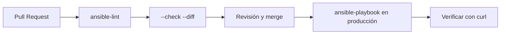

<h2>¿Para Qué Usar Ansible en un Pipeline CI/CD?</h2>
Integración

<h3 class="text-sm font-bold text-rose-300 mb-1">Sin pipeline</h3>
<ul class="text-xs text-slate-300 space-y-1 list-disc list-inside">
<li>Alguien corre el playbook desde su notebook, con su versión de Ansible.</li>
<li>Nadie revisa el cambio antes de aplicarlo.</li>
<li>No queda registro de quién cambió qué y cuándo.</li>
</ul>

<h3 class="text-sm font-bold text-emerald-300 mb-1">Con pipeline</h3>
<ul class="text-xs text-slate-300 space-y-1 list-disc list-inside">
<li>El cambio entra por Pull Request y lo revisa otra persona.</li>
<li>El lint y la simulación (<code>--check</code>) detectan errores antes de tocar producción.</li>
<li>Se ejecuta siempre en el mismo entorno y queda el historial en Git.</li>
</ul>

<strong class="text-cyan-300">Caso de uso: cambiar la configuración de nginx en producción.</strong>
Se edita la plantilla en una rama y se abre el Pull Request. El pipeline simula el cambio y muestra el diff en el PR. Tras aprobarlo y hacer merge, se aplica solo en <code>vm1</code> y <code>vm2</code>.

