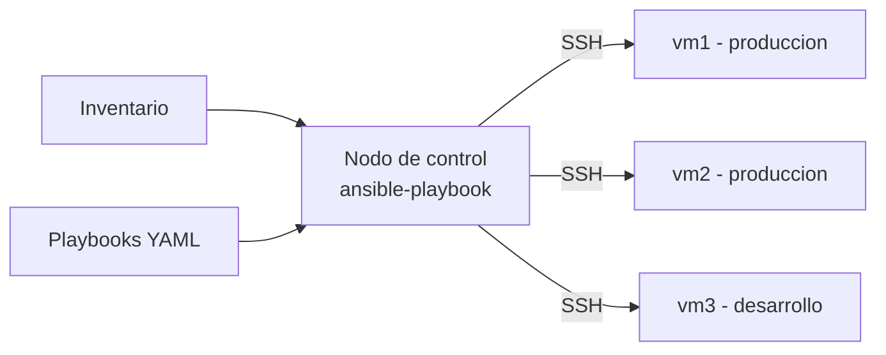

<h2>Arquitectura y Componentes</h2>
Arquitectura

<ul class="text-xs text-slate-300 space-y-1">
<li><strong>Nodo de control:</strong> la máquina desde donde se ejecuta Ansible.</li>
<li><strong>Nodos gestionados:</strong> los servidores que se configuran.</li>
<li><strong>Inventario:</strong> grupos y listas de hosts.</li>
</ul>

<ul class="text-xs text-slate-300 space-y-1">
<li><strong>Playbook:</strong> archivo YAML que agrupa tareas.</li>
<li><strong>Tarea (task):</strong> una acción sobre los hosts.</li>
<li><strong>Módulo:</strong> biblioteca de acciones, normalmente un wrapper de comandos.</li>
</ul>

