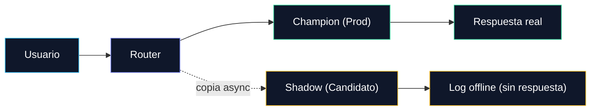

Infraestructura & Servido

<h2 class="text-2xl font-bold mb-2">
Estrategias de Despliegue Seguro
</h2>

<h3 class="text-sm font-semibold text-teal-400 mb-1">
🐤 Canary Deployment
</h3>

Se envía un % chico del tráfico real (ej. 5%) al modelo nuevo y se monitorean errores antes de escalar al 100%.

<ul class="text-[11px] text-slate-400 space-y-0.5">
<li>• <strong>Riesgo:</strong> ese % de usuarios sí recibe la respuesta del modelo nuevo.</li>
<li>• <strong>Ventaja:</strong> rollback inmediato si suben los errores.</li>
<li>• <strong>Variante A/B Testing:</strong> split fijo (no gradual) para medir métricas de negocio con significancia estadística.</li>
</ul>

<h3 class="text-sm font-semibold text-amber-400 mb-1">
👤 Shadow Testing
</h3>

El modelo candidato (<strong>shadow</strong>) recibe una copia del tráfico en paralelo al de producción (<strong>champion</strong>), pero su predicción <strong>nunca se devuelve al usuario</strong>.

<ul class="text-[11px] text-slate-400 space-y-0.5">
<li>• <strong>Riesgo:</strong> cero, nadie ve la predicción del modelo nuevo.</li>
<li>• <strong>Se compara offline:</strong> accuracy, latencia y error vs. el champion.</li>
<li>• <strong>Uso típico:</strong> modelos críticos (fraude, riesgo crediticio).</li>
</ul>

🔑 En <em>Canary</em> el usuario real recibe la respuesta del modelo nuevo; en <em>Shadow Testing</em> nunca la ve — es la opción de menor riesgo para validar con datos reales antes de exponerlo.

