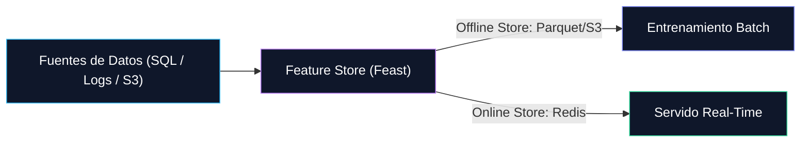

Fundamentos de Datos

<h2 class="text-2xl font-bold mb-2">
Feature Store &amp; Data Validation
</h2>

<h3 class="text-sm font-semibold text-purple-400 mb-1">
🗄️ Feature Store
</h3>

Resuelve el <strong>training-serving skew</strong>: que una feature se calcule distinto en el pipeline de entrenamiento y en producción.

<ul class="text-[11px] text-slate-400 space-y-0.5">
<li>• <strong>Offline Store:</strong> histórico (Parquet/S3), alimenta el entrenamiento batch.</li>
<li>• <strong>Online Store:</strong> baja latencia (Redis), alimenta la inferencia real-time.</li>
<li>• <strong>Extra:</strong> reutilización de features entre modelos y equipos.</li>
<li>• <strong>Herramientas:</strong> Feast, Tecton, Hopsworks.</li>
</ul>

<h3 class="text-sm font-semibold text-sky-400 mb-1">
✅ Data Validation
</h3>

Verifica que los datos cumplan un <strong>contrato de calidad</strong> (schema, tipos, rangos, nulos) antes de usarlos.

<ul class="text-[11px] text-slate-400 space-y-0.5">
<li>• <strong>En training:</strong> bloquea el pipeline si el dataset llega corrupto.</li>
<li>• <strong>En producción:</strong> gatea cada batch/request antes de que llegue al modelo.</li>
<li>• <strong>Ejemplo:</strong> rechazar un registro con <code>MonthlyCharges</code> negativo.</li>
<li>• <strong>Herramientas:</strong> Great Expectations, Whylogs, Pandera.</li>
</ul>

📌 Ambos son "puertas de calidad" antes del modelo: <em>Data Validation</em> asegura que el dato es válido; <em>Feature Store</em> asegura que es consistente entre training y producción.

